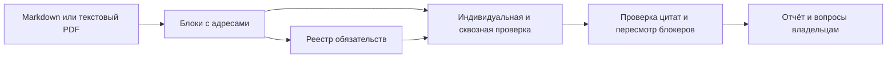

# Ревью требований до разработки

[Отчёт по заданию BCC-HUB](submission/report.md) · [Видео · 32 с](submission/demo.mp4) · [Исходное ТЗ](submission/requirements.md) · [Проверка качества и повторные прогоны](evals/README.md)

Агент показывает, какие решения нужны владельцу продукта, чтобы разработчик и тестировщик получили один ожидаемый результат. Каждый вывод связан с местом в исходном документе. В начале отчёта отдельно оценивается готовность к разработке и тестированию.

## Как проверить результат за минуту

1. Откройте отчёт и найдите покупку 31 января, проведённую 1 февраля. Сравните обе цитаты с исходным ТЗ.
2. Откройте [результат повторного прогона](submission/corrected-report.md). В копии входного документа изменено одно слово: «Февральский» → «Январский».
3. Сверьте выводы на двух версиях. В [оценке](evals/README.md) отдельно приведены пропуски, ложные блокеры и сравнение с однопроходным запросом.

Повторить исправление из видео можно из корня репозитория:

```sh
sed 's/Февральский счётчик вырос/Январский счётчик вырос/' submission/requirements.md > organizer-corrected.md
uv run --locked validator review organizer-corrected.md --out corrected-report.md
```

## Запуск

Установите Python 3.11+ и [uv](https://docs.astral.sh/uv/getting-started/installation/). Создайте ключ в [OpenAI Platform](https://platform.openai.com/api-keys) с доступом к Responses API и модели. Из корня репозитория:

```sh
cp .env.example .env
# Заполните OPENAI_API_KEY в .env
uv run --locked validator review submission/requirements.md --out report.md
```

Команда установит зафиксированные зависимости и создаст отчёт на русском языке. Модель по умолчанию — `gpt-6-luna`. Переменная `OPENAI_MODEL` меняет модель. При необходимости добавьте `--audit run.json`, чтобы сохранить структурированные выводы, реестр, число токенов и паспорт прогона. Не публикуйте ключ. Текст документа передаётся в OpenAI API.

## Как проходит проверка



Парсер сохраняет диапазоны строк Markdown, заголовки разделов, заголовки столбцов и примеры ответов. Для PDF адресом служит страница. Модель разбирает блоки пакетами, затем получает весь реестр вместе с оригиналом и сравнивает положения разных разделов. Для числовых столбцов Markdown агент ищет явные равенства единиц и пересчитывает примеры точными дробями. Модель проверяет, относятся ли колонки к одной величине и действует ли правило в этом примере. Ещё один проход проверяет условия, исключения и единицы измерения. Код проверяет ссылки, формирует итоговые числа и сохраняет результат. Проверка точности цитаты подтверждает её наличие в источнике. Смысл вывода оценивается отдельно.

Вход ограничен 150 000 символами текста с контекстом. Скан, повреждение файла, отсутствие текстового слоя и исчерпанные попытки модели дают диагностический отчёт и код возврата 1. PDF читается по текстовым блокам в порядке страницы. Сложные многоколоночные таблицы лучше передавать в Markdown. Для полного документа с результатами проверки используйте выходной путь, отличный от оригинала.

## Воспроизведение

```sh
uv run --locked pytest -q
uv run --locked python evals/benchmark.py holdout --out evaluation-runs/holdout
```

Вторая команда выполняет платные запросы к API. Без сетевого доступа тесты проверяют парсер, контроль доказательств, ошибки входа и сборку отчёта на тестовом ответе. Версия агента, хеш входа и имя модели записываются в паспорт. Формулировки и число выводов могут отличаться между запусками.

Исходный документ взят из [задания организаторов, ревизия 928c1aa](https://github.com/BCC-HUB/ai-requirements-validator-task/blob/928c1aa364265426105b69ba7a3444eac11b22db/docs/requirements.md).
