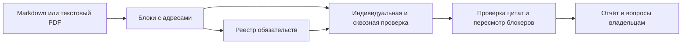

# Ревью требований до разработки

[Отчёт по заданию BCC-HUB](submission/report.md) · [Видео · 48 с](submission/demo.mp4) · [Исходное ТЗ](submission/requirements.md) · [Проверка качества и повторные прогоны](evals/README.md)

Агент проводит статическое ревью технического задания по критериям ISO/IEC/IEEE 29148:2018 и IEEE 830 до начала разработки и показывает, какие решения нужны владельцам требований, чтобы разработка и QA получили один ожидаемый результат. Каждый вывод подтверждён дословной цитатой и точным адресом в исходном документе. На первом экране отчёта сразу выведены вердикт готовности и все блокеры с вопросами владельцам.

## Как проверить результат за минуту

1. Откройте [отчёт по выданному ТЗ](submission/report.md): на первом экране выведены все 5 блокеров (`D001`–`D005`: конфликт месяца покупки, лимит `1 push/мес` vs смена порога, `GET /alerts/saveLimit` чтение vs сохранение, `HTTP 200 + ERROR` vs `400`, чужая карта `403` vs `404`) и 2 существенных пробела (`D006`–`D007`: контракт `HTTP 201`, проверка активности и валюты KZT).
2. Откройте [результат контрольного прогона](submission/corrected-report.md): в копии ТЗ изменено ровно одно слово — «Февральский» → «Январский» в строке 64.
3. Сверьте два отчёта: конфликт месяца (`D001`) исчез, число блокеров снизилось (`5 → 3`, всего дефектов `7 → 5`), а независимые дефекты сохранились без новых ложных тревог. В [оценке](evals/README.md) приведены слепые прогоны и сравнение с однопроходным запросом (`--baseline`).

Повторить исправление из видео можно из корня репозитория:

```sh
sed 's/Февральский счётчик вырос/Январский счётчик вырос/' submission/requirements.md > organizer-corrected.md
uv run --locked validator review organizer-corrected.md --out corrected-report.md
```

## Запуск

Установите Python 3.11+ и [uv](https://docs.astral.sh/uv/getting-started/installation/). Создайте ключ в [OpenAI Platform](https://platform.openai.com/api-keys) с доступом к Responses API и модели. Из корня репозитория:

```sh
cp .env.example .env
# Заполните OPENAI_API_KEY в .env
uv run --locked validator review submission/requirements.md --out report.md
```

Команда установит зафиксированные зависимости и создаст отчёт на русском языке. Модель по умолчанию — `gpt-6-luna`. Переменная `OPENAI_MODEL` меняет модель. При необходимости добавьте `--audit run.json`, чтобы сохранить структурированные выводы, реестр, число токенов и паспорт прогона. Не публикуйте ключ. Текст документа передаётся в OpenAI API.

## Как проходит проверка



Парсер сохраняет диапазоны строк Markdown, заголовки разделов, заголовки столбцов (не превращая шапки таблиц в фиктивные требования) и примеры ответов. Для PDF адресом служит страница. Извлечение реестра выполняется параллельными пакетами с сохранением стабильных ID блоков и отсевом шаблонных/справочных секций, после чего модель получает весь реестр вместе с оригиналом для сквозной проверки. Для числовых столбцов Markdown агент выполняет двунаправленную проверку явных равенств единиц (включая падежные формы и встроенные символы валют вроде `123,45 ₸`) точными дробями. Проход критика проверяет исключения, округления и полноту относительно реестра. Валидатор строго отклоняет выдуманные или неточные цитаты (никакой подмены полным блоком) и отправляет вывод на исправление.

Вход ограничен 150 000 символами текста с контекстом. Повреждённый PDF, защищённый PDF, скан без текстового слоя, пустой документ и сбой API формируют понятный диагностический отчёт на русском языке (без утечки внутренних путей и ключей) и завершаются с кодом возврата `1`. Для полного документа с результатами проверки используйте выходной путь, отличный от оригинала.

## Воспроизведение

```sh
uv run --locked pytest -q
uv run --locked python evals/benchmark.py holdout --out evaluation-runs/holdout
```

Вторая команда выполняет платные запросы к API. Без сетевого доступа тесты проверяют парсер, контроль доказательств, ошибки входа и сборку отчёта на тестовом ответе. Версия агента, хеш входа и имя модели записываются в паспорт. Формулировки и число выводов могут отличаться между запусками.

Исходный документ взят из [задания организаторов, ревизия 928c1aa](https://github.com/BCC-HUB/ai-requirements-validator-task/blob/928c1aa364265426105b69ba7a3444eac11b22db/docs/requirements.md).
